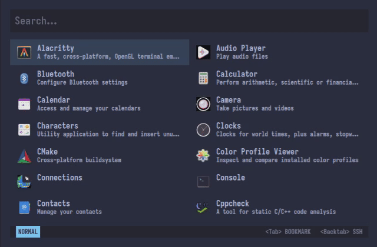

One of the goals I have with `AhoiPlank` is making it pleasant to look like and to use, the same way I have with `neovim`. As I started adding modes to it such as Dotfiles, SSH and Bookmarks, I realized I could be one key away from switching it without leaving the environment.

Neovim is so great, why would anyone ever press `:q`? Now it can switch on the fly by pressing Tab and Backtab. A small .gif demonstrates it:

I am also moving towards allowing full configuration kind of like `Waybar` does, as well as a Projects mode, where the user can pin and unpin their working projects with less keystrokes. A custom script runner mode is also an upcoming idea.

Alex
